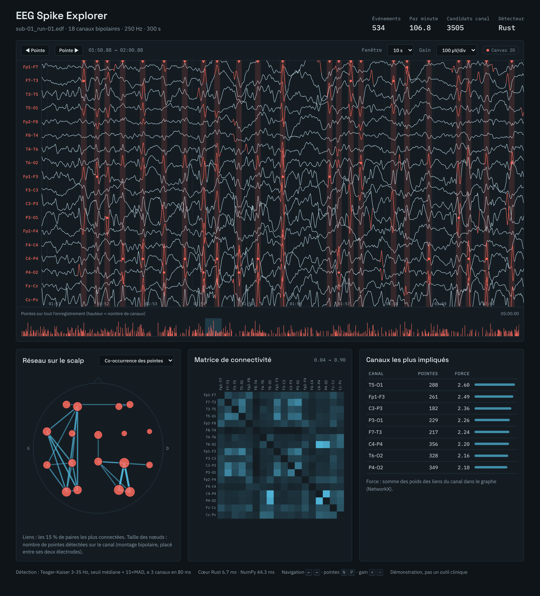
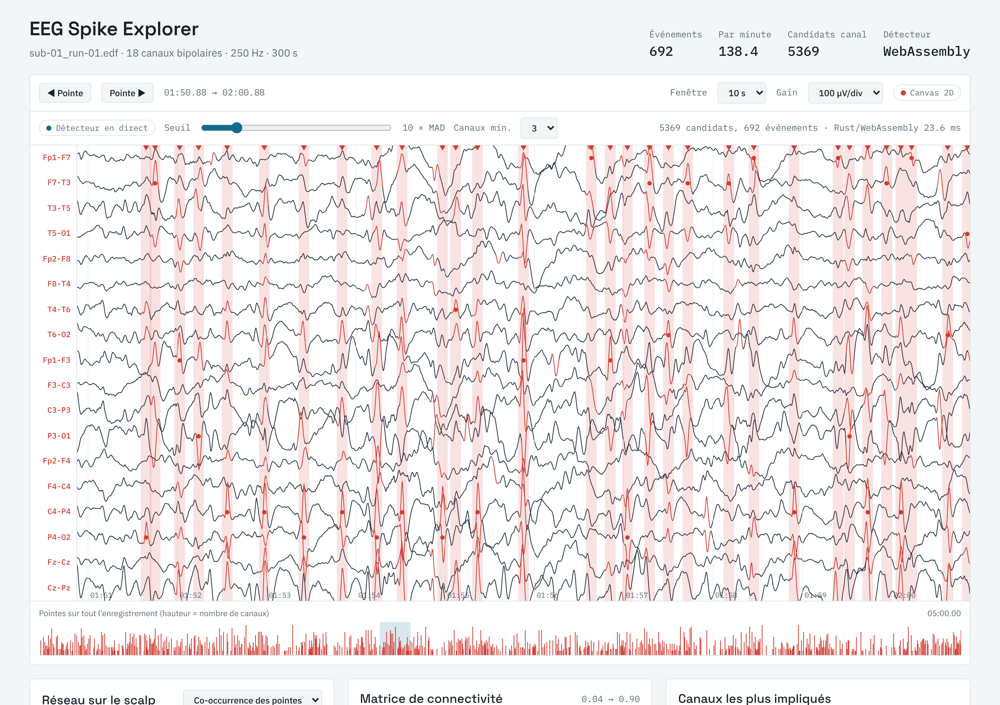
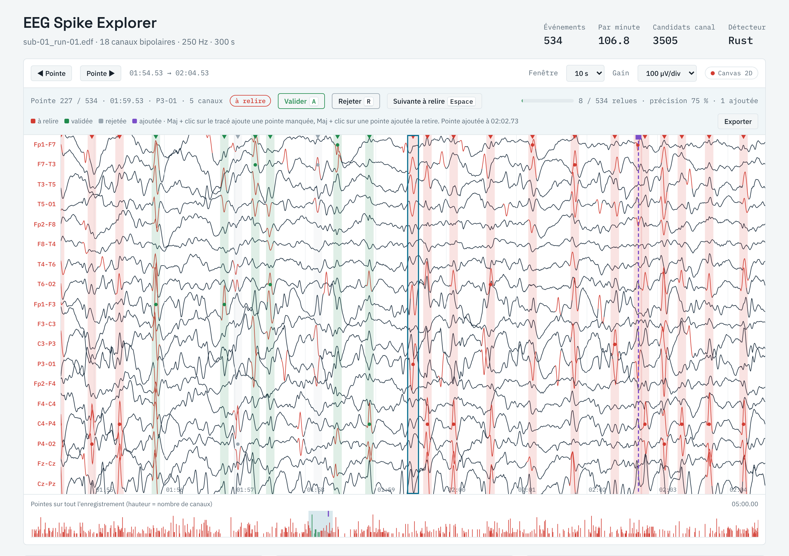

# EEG Spike Explorer

Détection automatique de **pointes intercritiques** et analyse de **connectivité entre électrodes** sur de l'EEG de scalp d'enfants épileptiques, avec **MNE-Python**, un cœur de détection en **Rust** (PyO3) et un visualiseur interactif **WebGPU**.

Projet réalisé en une soirée (novembre 2026) pour montrer une chaîne complète, de l'EDF brut à une interface utilisable par un clinicien, en m'appuyant sur un assistant IA pour aller vite sur les parties interface et Rust.



## Ce que fait le projet

```
EDF ──► MNE : notch 50 Hz, passe-bande 1-70 Hz, rééchantillonnage 250 Hz, montage bipolaire 10-20
    ──► détection de pointes (Teager-Kaiser + seuil robuste)   ← NumPy, Rust (PyO3) ou Rust (WebAssembly) : mêmes résultats
    ──► regroupement multi-canaux en événements
    ──► connectivité : wPLI par bande (MNE-Connectivity), corrélation, co-occurrence des pointes
    ──► graphe NetworkX : force, centralité, canaux « hubs »
    ──► viewer.html autonome (WebGPU, repli Canvas 2D) + CSV/JSON
```

Sur l'enregistrement de démonstration (sujet 01, 5 min de sommeil N3) :

| | |
|---|---|
| Événements détectés | 534 (≈ 107 / min, activité pointe-onde quasi continue) |
| Canaux les plus impliqués | T5-O1, Fp1-F3, C3-P3 (co-occurrence) |
| Détection Rust vs NumPy | ≈ 4 à 7× plus rapide, sorties identiques (testé) |
| Pipeline complet | ≈ 5 s sur un portable |

## Un seul cœur Rust, deux cibles : Python et navigateur

```
rust/core/   eegspike-core : le détecteur, en Rust pur, sans dépendance
   ├── rust/   → module Python via PyO3 (multithread, sans GIL)       utilisé par l'analyse
   └── wasm/   → WebAssembly (26 Ko), embarqué dans viewer.html       utilisé par l'interface
```

Dans le visualiseur, le **curseur de seuil** relance la détection sur les 5 minutes et les 18 canaux **directement dans le navigateur**, en 20 à 40 ms : on voit tout de suite combien de pointes apparaissent ou disparaissent. Même code Rust, donc mêmes pointes que Python : au seuil par défaut, le navigateur retrouve exactement les 3 505 candidats et 534 événements de l'analyse Python (un test le vérifie sur des signaux synthétiques).



## Mode relecture : le clinicien corrige le détecteur

```bash
uv sync --extra app
uv run eegspike review data/sub-01_run-01.edf -o results    # ouvre http://127.0.0.1:8765
```



Un petit serveur **FastAPI** sert l'interface et une API REST. Pour chaque pointe proposée, le relecteur tape **A** (valider) ou **R** (rejeter) et passe automatiquement à la suivante. **Maj + clic** sur le tracé ajoute une pointe que le détecteur a ratée.

- Chaque décision est écrite tout de suite dans `results/review.json` : on peut fermer et reprendre plus tard.
- Compteur en direct : pointes relues et **précision du détecteur** (part des détections confirmées). Une fois tout relu, les pointes ajoutées donnent aussi le **rappel** (part des vraies pointes trouvées).
- **Exporter** écrit `*_review.csv`, `*_events.tsv` au format **BIDS** et `*_spikes-annot.fif`, lisible par `mne.read_annotations`.

C'est la boucle qui manque au détecteur : les corrections d'un expert deviennent des annotations, qui servent à mesurer le détecteur puis à en entraîner un meilleur.

| Méthode | Route | Rôle |
|---|---|---|
| GET | `/api/review` | décisions, pointes ajoutées, statistiques |
| PUT | `/api/review/events/{sample}` | `{"status": "accepted" \| "rejected" \| "pending"}` |
| POST | `/api/review/added` | `{"t": 12.34}` ajoute une pointe manquée |
| DELETE | `/api/review/added/{id}` | retire une pointe ajoutée |
| POST | `/api/review/export` | écrit CSV, BIDS et annotations MNE |

## Démarrage rapide

```bash
uv sync --extra dev                    # environnement Python complet en quelques secondes (uv.lock)
(cd rust && uv run maturin build --release && uv pip install target/wheels/*.whl)   # optionnel : cœur Rust
scripts/download_data.sh 01 01         # 5 min d'EEG, OpenNeuro ds003555 (CC0)
uv run eegspike run data/sub-01_run-01.edf -o results
open results/viewer.html               # Chrome / Edge / Safari 18+ pour WebGPU
```

Sorties dans `results/` : `spike_events.csv`, `spike_candidates.csv`, `graph_hubs.csv`, `connectivity.npz`, `summary.json`, `viewer.html`.

Utilisation en bibliothèque :

```python
import eegspike as es
raw = es.load_eeg("data/sub-01_run-01.edf")
spikes = es.detect_spikes(raw)                 # backend="auto" | "rust" | "numpy"
mats = es.compute_connectivity(raw, spikes.events)
g = es.connectivity_graph(mats["wpli_delta"], raw.ch_names)
```

## Méthode

**Détection** (`src/eegspike/detect.py`, `rust/src/lib.rs`)
1. Passe-bande 3-35 Hz pour garder la composante pointue des pointes.
2. Opérateur d'énergie de Teager-Kaiser `x[t]² − x[t−1]·x[t+1]`, grand quand le signal est à la fois ample et rapide, lissé sur 20 ms.
3. Seuil adaptatif par canal : `médiane + k·MAD/0.6745` (k = 15), robuste aux artefacts.
4. Maxima locaux au-dessus du seuil, période réfractaire de 200 ms.
5. Une pointe a un champ spatial : on garde les détections vues sur ≥ 3 canaux en moins de 80 ms.

Les étapes 2 à 4 existent en NumPy (référence lisible) et en Rust (`rust/core`), compilé pour Python (multithread, sans GIL) et pour le navigateur (WebAssembly). Les tests vérifient que les trois donnent exactement les mêmes pointes.

**Connectivité** (`src/eegspike/connectivity.py`)
- **wPLI** (weighted Phase Lag Index) sur des époques de 2 s, bandes delta, thêta, alpha, bêta. Il ignore le couplage à déphasage nul, donc limite l'effet de conduction volumique.
- **Co-occurrence des pointes** (indice de Jaccard) : quels canaux « pointent » ensemble, une approximation de l'étendue de la zone irritative.
- **Corrélation** comme référence simple.
- Graphe NetworkX sur les 15 % de liens les plus forts : force, centralité de degré et d'intermédiarité.

**Visualiseur** (`src/eegspike/viewer_template.html`)
- Un seul fichier HTML, sans serveur ni dépendance, généré par Python avec les données embarquées (int16, ≈ 7,4 Mo pour 5 min × 18 canaux : signal affiché + bande de détection + module WebAssembly).
- Rendu WebGPU : tout le signal est chargé une fois dans un *storage buffer* ; un shader WGSL dessine chaque canal comme une instance de `line-strip`. Se déplacer dans le tracé ne met à jour que 64 octets d'uniformes. Repli automatique en Canvas 2D si WebGPU est absent.
- Navigation clavier (← →, N/P pour pointe suivante/précédente, +/− pour le gain), frise des événements cliquable, réseau sur le scalp et matrice de connectivité au choix de la mesure.

## Tests

```bash
uv run pytest -q                       # 15 tests : détection, Rust == NumPy == WebAssembly, graphe, API de relecture
cargo test --manifest-path rust/core/Cargo.toml        # tests unitaires du cœur Rust
uv run ruff check src tests && uv run ty check src     # style (Ruff) et types (ty)

# reconstruire le module WebAssembly
cargo build --release --manifest-path wasm/Cargo.toml --target wasm32-unknown-unknown
cp wasm/target/wasm32-unknown-unknown/release/eegspike_wasm.wasm src/eegspike/eegspike_core.wasm
```

L'intégration continue (GitHub Actions) fait tout cela à chaque push : installation avec **uv**, **Ruff**, **ty**, compilation PyO3 et WebAssembly, puis les tests.

## Données

[OpenNeuro ds003555](https://openneuro.org/datasets/ds003555) : EEG de sommeil de 30 enfants épileptiques (Hôpital pédiatrique de Zurich), segments N3 de 5 minutes en montage bipolaire, 2000 Hz, licence CC0. Le code lit n'importe quel EDF : il prend le montage « double banane » si les canaux existent, sinon tous les canaux EEG. Il fonctionne donc aussi sur CHB-MIT (PhysioNet).

## Limites et suites

- **Pas un outil clinique.** Le détecteur est volontairement simple et n'a pas été validé contre des annotations d'experts (ce jeu de données annote les HFO, pas les pointes). L'étape suivante serait une évaluation sensibilité / précision sur un jeu annoté, puis la comparaison avec un détecteur appris (CNN 1D en PyTorch).
- Connectivité en espace capteurs bipolaire : utile pour comparer des canaux, mais l'interprétation anatomique demanderait une reconstruction de sources.
- Relecture : plusieurs relecteurs et accord inter-experts, sélection de canaux, réentraînement d'un détecteur appris à partir des annotations exportées.

## Auteur

Valentin Goupille, M2 bio-informatique. [valentingoupille.com](https://valentingoupille.com)
